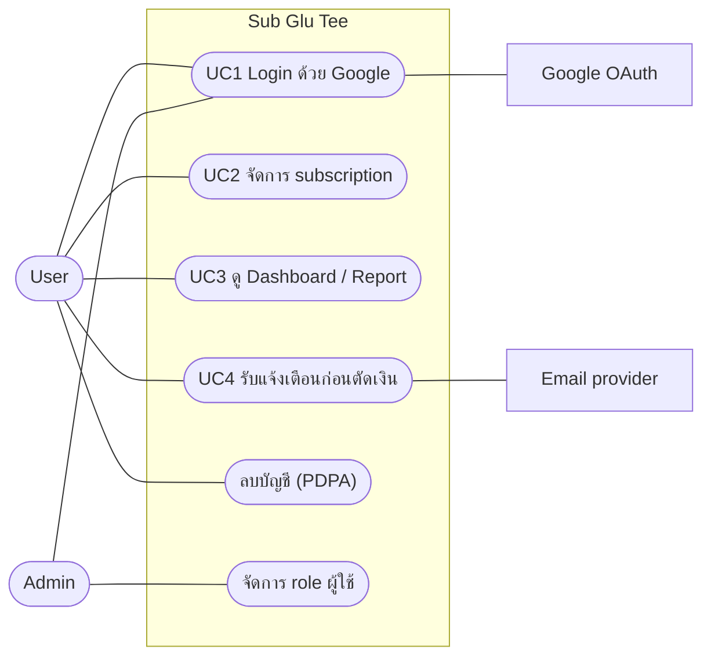
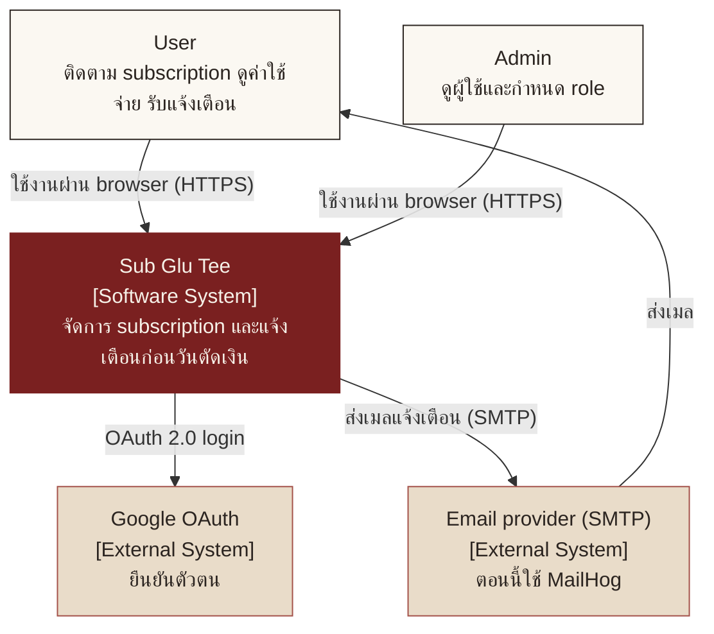
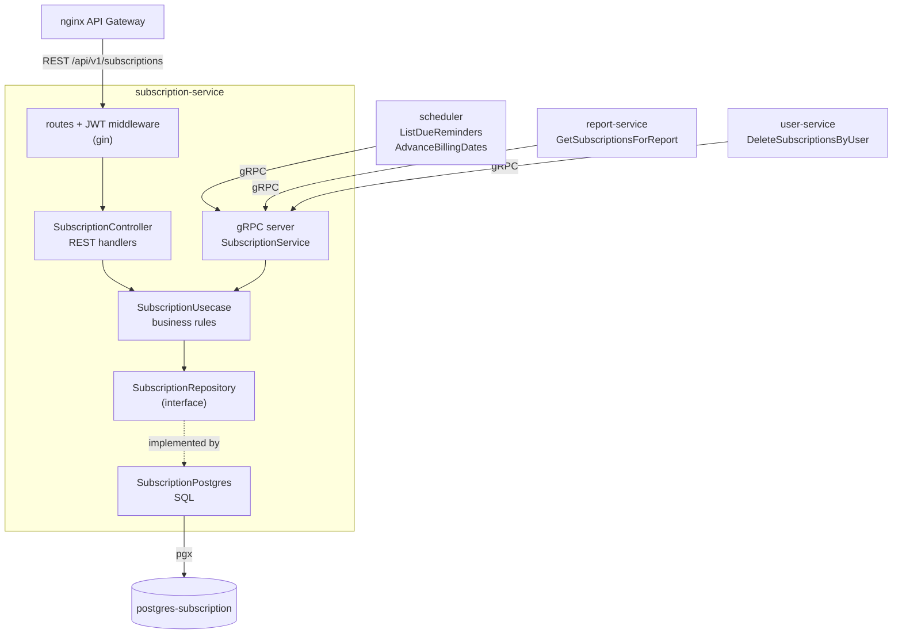
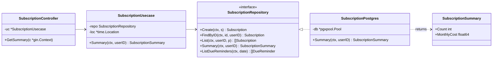
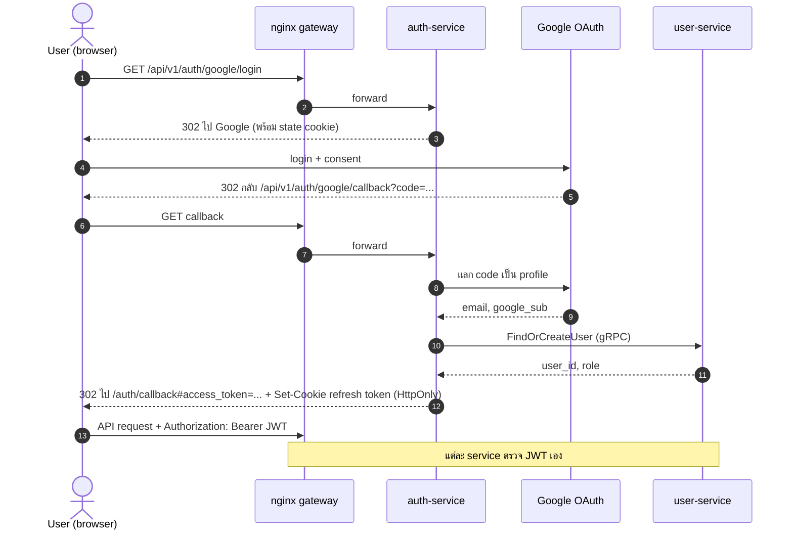
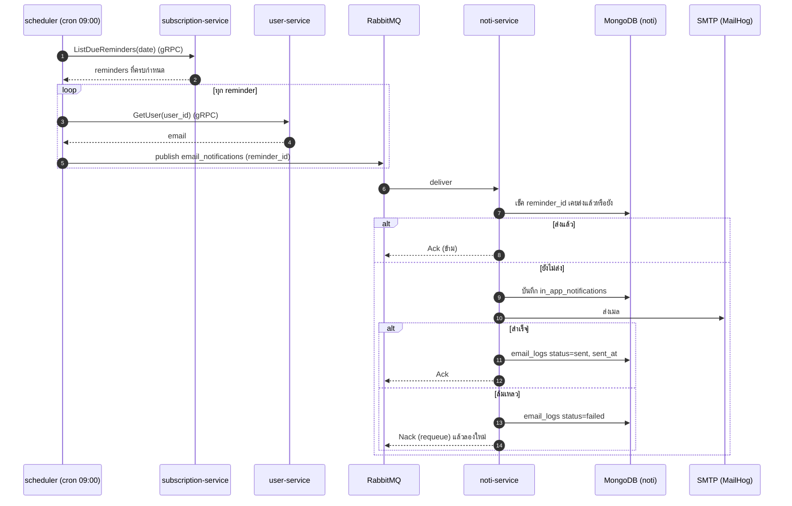
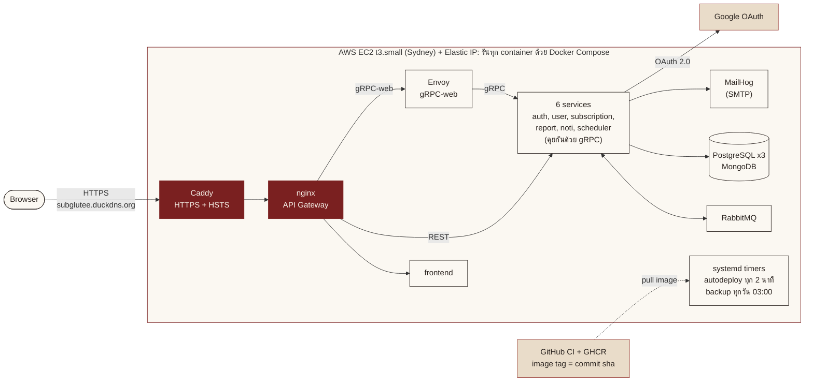

# Diagrams

โค้ด Mermaid ของ diagram ในสไลด์ final วางลงใน https://mermaid.live แล้ว export เป็น PNG หรือ SVG ไปแปะในช่อง `[รูป: ...]` ของสไลด์

C4 Level 2 ใช้ภาพ architecture เดิมจากสไลด์ Deli 5

## use-cases

Use case diagram (Mermaid ไม่มี use case diagram โดยตรง จึงใช้ flowchart และวงรีแทน)

## c4-l1

C4 Level 1: System Context

## c4-l3

C4 Level 3: Component ของ subscription-service

## c4-l4

C4 Level 4: Code ของ use case สรุปค่าใช้จ่ายรายเดือน (`GET /api/v1/subscriptions/summary`)

ใน `SubscriptionPostgres.Summary` ยอดรวมคำนวณใน SQL: `ROUND(SUM(CASE WHEN type = 'yearly' THEN cost / 12 ELSE cost END), 2)` บนคอลัมน์ `NUMERIC(10,2)`

## seq-login

## seq-reminder

## deployment

Deployment Overview: EC2 เครื่องเดียว รันทุก container ด้วย Docker Compose

